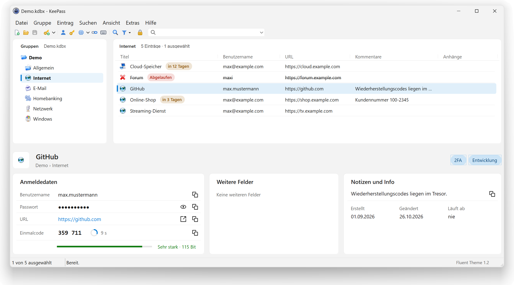
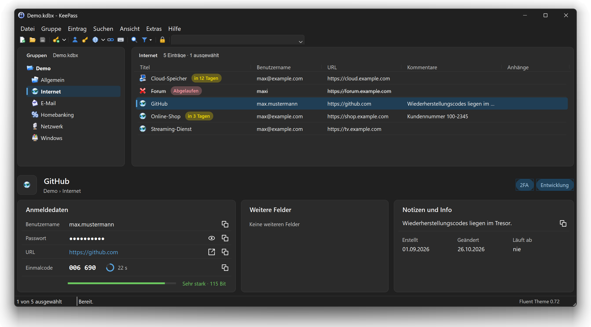
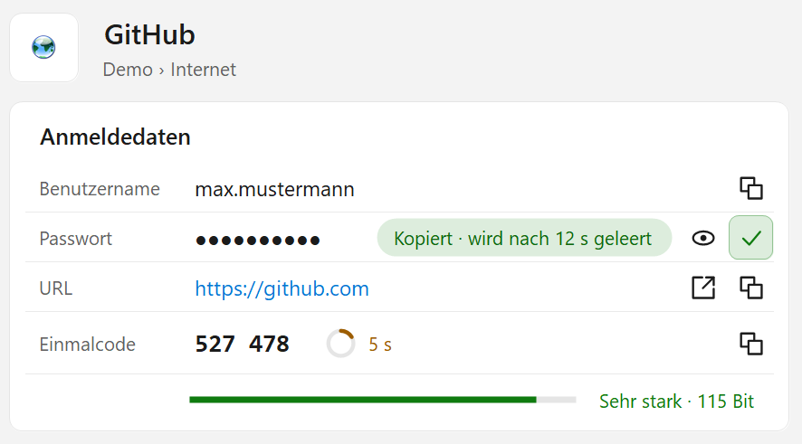
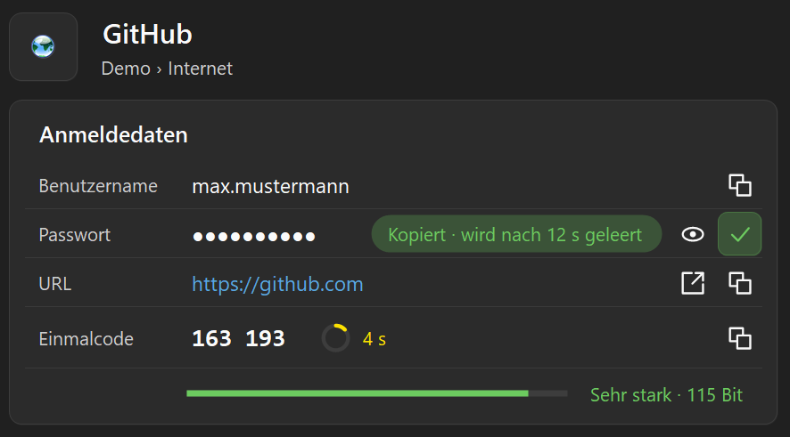
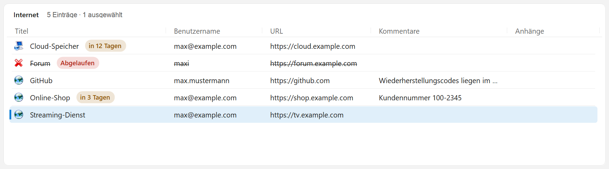
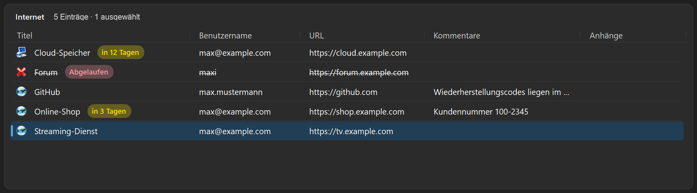
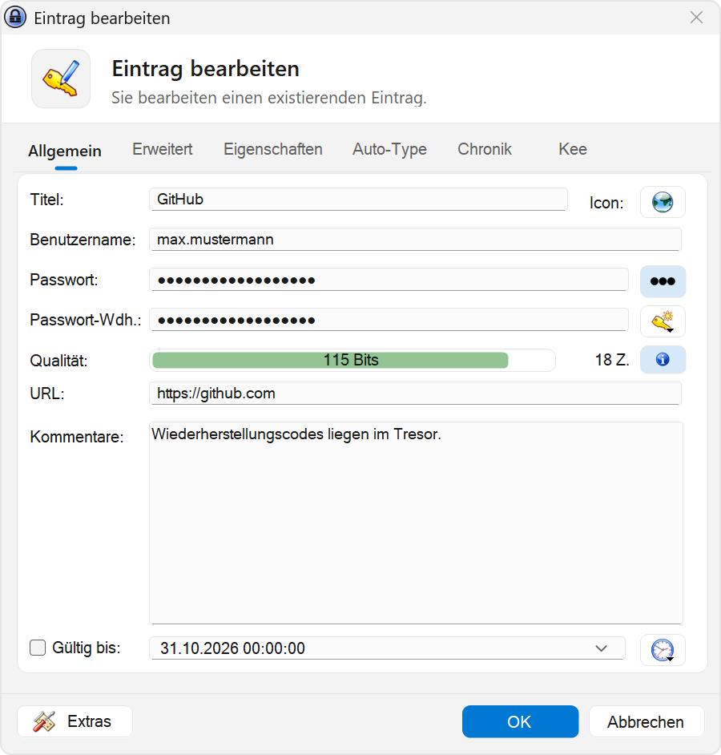
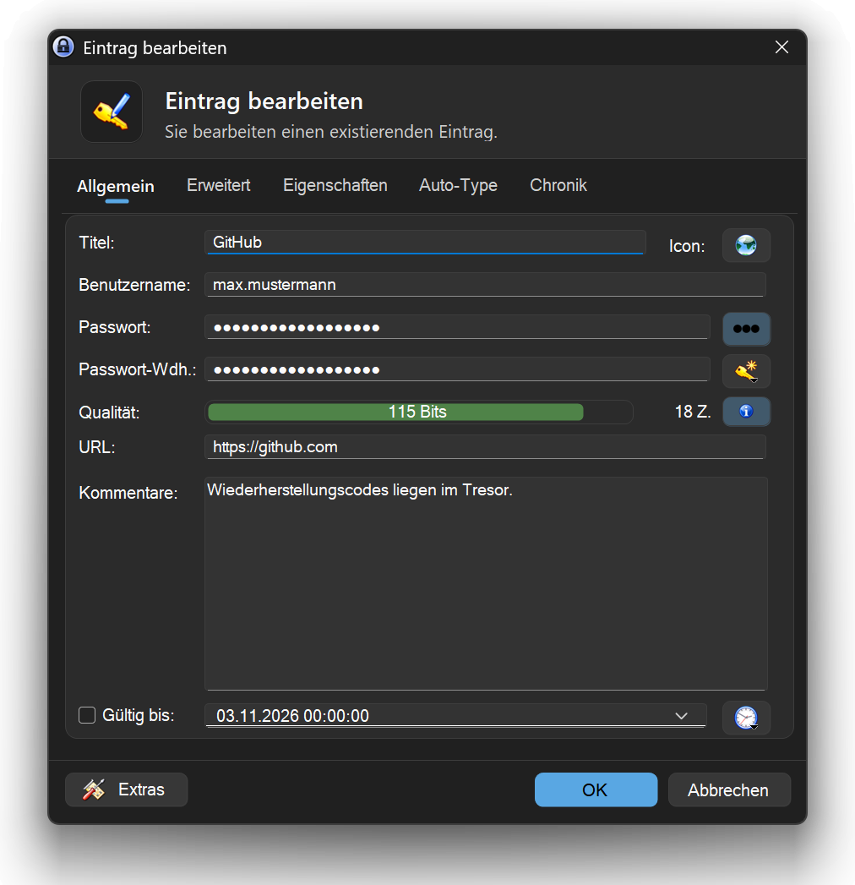
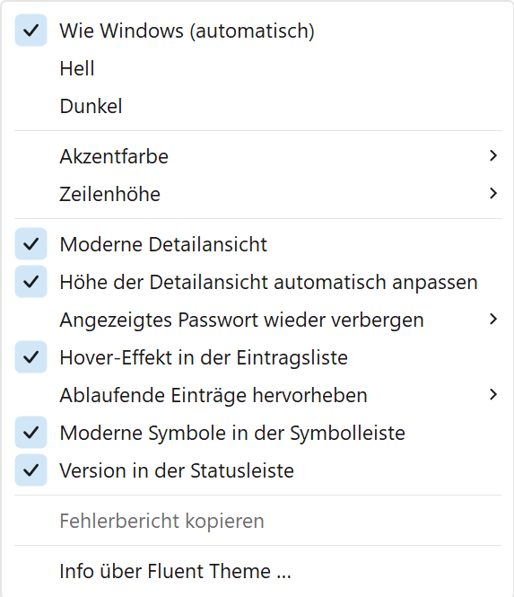
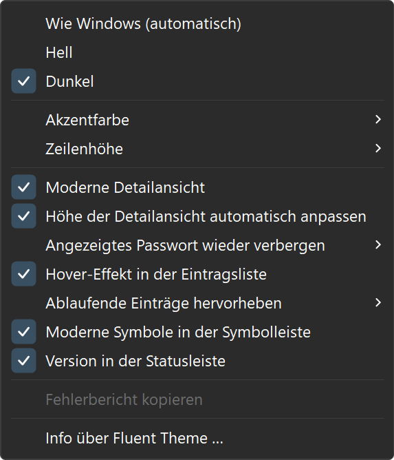

# KeePass Fluent Theme

**[English](#english) · [Deutsch](#deutsch)**

<table>
  <tr>
    <td></td>
    <td></td>
  </tr>
  <tr>
    <td align="center">Light · Hell</td>
    <td align="center">Dark · Dunkel</td>
  </tr>
</table>

Author / Autor: Günther Schoder · [www.westmc002.de](https://www.westmc002.de)

---

## English

Modern Windows 11 look for [KeePass 2.x](https://keepass.info/) – light/dark mode, Windows accent color, entry details as cards, display of TOTP one-time codes and expiry hints. The familiar KeePass layout stays: group tree on the left, entry list on the right, entry details below.

The plugin speaks **English and German** and follows the language of KeePass.

### Features

- **Windows 11 colors** in light and dark mode – follows Windows or fixed
- **Windows accent color** or a custom accent color
- **Modern interface:** menus with rounded corners, colored Fluent icons in the toolbar, tabs, slim scroll bars, modern search box
- **Group tree and entry list** with rounded selection, accent bar and hover effect; adjustable row height
- **Expiry hints:** red badge “Expired”, orange badge “in x days” (time span adjustable)
- **Entry details as cards**
  - credentials with copy, show and open buttons and password strength
  - **display of the one-time code (TOTP)** with countdown and copy button – reads KeePass' `TimeOtp-*` fields and an `otp` field in KeePassXC/KeeOtp format. Two-factor login is still set up in KeePass or a TOTP plugin; Fluent Theme only displays the code.
  - other fields (e.g. “URL 2”), clickable links
  - notes with copy button, long notes can be expanded
  - open or save attachments with one click
  - clickable tags (shows all entries with that tag)
- **“Copied” hint** with the time after which KeePass clears the clipboard
- A revealed password is **hidden again automatically** after an adjustable time
- The height of the entry details **adapts automatically** to the entry
- **Restyled KeePass dialogs:** header, tabs, content on a card, consistent input fields with accent line, quality bar in traffic-light colors, buttons – for all KeePass dialogs (entry, group, options, password generator …)

All settings: **Tools › Fluent Design**.

### Installation

1. Close KeePass.
2. Copy `FluentTheme.dll` from the [Releases](https://github.com/WestMc002/KeePass-Fluent-Theme/releases) into the `Plugins` folder of KeePass, e.g. `C:\Program Files (x86)\KeePass\Plugins` (administrator rights required).
3. Start KeePass.

Requirements: KeePass 2.x on Windows 10 or 11 (rounded corners and some details only on Windows 11).

Updates: KeePass reports new versions under **Help › Check for Updates** (file `keepass.version`).

### Building from source

Run `Erstellen.bat` in the project folder. It

- compiles with the C# compiler of .NET Framework 4 (no other software needed),
- assigns the version number automatically (Major.Minor.Year.MonthDay),
- backs up the project to `Backup`,
- copies the DLL into the Plugins folder and restarts KeePass.

The KeePass path is set in `Erstellen.bat` in the block “Einstellungen” (`KPDIR`).

---

## Deutsch

Modernes Windows-11-Design für [KeePass 2.x](https://keepass.info/) – Hell/Dunkel, Windows-Akzentfarbe, Detailansicht mit Karten, Anzeige von TOTP-Einmalcodes und Ablauf-Hinweisen. Das gewohnte KeePass-Layout bleibt erhalten: Gruppenbaum links, Eintragsliste rechts, Detailansicht darunter.

Das Plugin spricht **Deutsch und Englisch** und folgt der Sprache von KeePass.

### Funktionen

- **Windows-11-Farben** im hellen und dunklen Modus – folgt Windows oder fest eingestellt
- **Windows-Akzentfarbe** oder eine eigene Akzentfarbe
- **Moderne Oberfläche:** Menüs mit abgerundeten Ecken, farbige Fluent-Symbole in der Symbolleiste, Registerkarten, schmale Scrollleisten, modernes Suchfeld
- **Gruppenbaum und Eintragsliste** mit abgerundeter Auswahl, Akzentstreifen und Hover-Effekt; Zeilenhöhe einstellbar
- **Ablauf-Hinweise:** rotes Badge „Abgelaufen“, oranges Badge „in x Tagen“ (Zeitspanne einstellbar)
- **Detailansicht als Karten**
  - Anmeldedaten mit Kopieren-, Anzeigen- und Öffnen-Knöpfen und Passwortstärke
  - **Anzeige des Einmalcodes (TOTP)** mit Countdown und Kopieren-Knopf – liest die `TimeOtp-*`-Felder von KeePass sowie ein Feld `otp` im Format von KeePassXC/KeeOtp. Eingerichtet wird die Zwei-Faktor-Anmeldung weiterhin in KeePass bzw. einem TOTP-Plugin; das Fluent Theme zeigt den Code nur an.
  - weitere Felder (z. B. „URL 2“), Links anklickbar
  - Notizen mit Kopieren-Knopf, lange Notizen aufklappbar
  - Anhänge per Klick öffnen oder speichern
  - Tags anklickbar (zeigt alle Einträge mit diesem Tag)
- **„Kopiert“-Hinweis** mit der Zeit, nach der KeePass die Zwischenablage leert
- Angezeigtes Passwort wird nach einstellbarer Zeit **automatisch wieder verborgen**
- Höhe der Detailansicht passt sich **automatisch** an den Eintrag an
- **Gestaltete KeePass-Dialoge:** Kopfbereich, Registerkarten, Inhalt auf einer Karte, einheitliche Eingabefelder mit Akzentlinie, Qualitätsbalken in Ampelfarben, Knöpfe – gilt für alle KeePass-Dialoge (Eintrag, Gruppe, Optionen, Passwort-Generator …)

Alle Einstellungen: **Extras › Fluent-Design**.

### Installation

1. KeePass beenden.
2. `FluentTheme.dll` aus den [Releases](https://github.com/WestMc002/KeePass-Fluent-Theme/releases) in den Ordner `Plugins` von KeePass kopieren, z. B. `C:\Program Files (x86)\KeePass\Plugins` (Administratorrechte nötig).
3. KeePass starten.

Voraussetzungen: KeePass 2.x unter Windows 10 oder 11 (runde Ecken und einige Details nur unter Windows 11).

Updates: KeePass meldet neue Versionen unter **Hilfe › Nach Updates suchen** (Datei `keepass.version`).

### Selbst kompilieren

`Erstellen.bat` im Projektordner starten. Sie

- kompiliert mit dem C#-Compiler des .NET Framework 4 (keine weitere Software nötig),
- vergibt die Versionsnummer automatisch (Haupt.Neben.Jahr.MonatTag),
- sichert das Projekt unter `Backup`,
- kopiert die DLL in den Plugins-Ordner und startet KeePass neu.

Der KeePass-Pfad ist in der `Erstellen.bat` im Block „Einstellungen“ hinterlegt (`KPDIR`).

---

## Screenshots

<table>
  <tr>
    <td></td>
    <td></td>
  </tr>
  <tr><td colspan="2" align="center">Entry details with one-time code and “Copied” hint · Detailansicht mit Einmalcode und „Kopiert“-Hinweis</td></tr>
  <tr>
    <td></td>
    <td></td>
  </tr>
  <tr><td colspan="2" align="center">Expiry badges · Ablauf-Hinweise</td></tr>
  <tr>
    <td></td>
    <td></td>
  </tr>
  <tr><td colspan="2" align="center">Restyled dialogs · Gestaltete Dialoge</td></tr>
  <tr>
    <td></td>
    <td></td>
  </tr>
  <tr><td colspan="2" align="center">Settings (Tools › Fluent Design) · Einstellungen (Extras › Fluent-Design)</td></tr>
</table>

Screenshots show the German interface with a demo database · Die Bilder zeigen die deutsche Oberfläche mit einer Demo-Datenbank.

## Project structure / Projektaufbau

| Folder / file · Ordner / Datei | Content · Inhalt |
|---|---|
| `Quellcode` | C# source code · C#-Quellcode |
| `Resources` | embedded resources (logo) · eingebettete Ressourcen (Logo) |
| `Screenshots` | images for this page (demo database) · Bilder für diese Seite (Demo-Datenbank) |
| `Erstellen.bat` | build script · Build-Skript |
| `ReadMe.txt` / `Liesmich.txt` | manual (English / German) · Anleitung (Englisch / Deutsch) |
| `keepass.version` | version file for the KeePass update check · Versionsdatei für die Update-Prüfung von KeePass |

## License / Lizenz

GNU General Public License v3.0 or later · GNU General Public License v3.0 oder später – [LICENSE](LICENSE).

© 2026 Günther Schoder

**Exception / Ausnahme:** The GS logo (`Resources/GS-Logo.png`) is excluded from the GPL. All rights reserved; it may only be redistributed unchanged together with this plugin. · Das GS-Logo (`Resources/GS-Logo.png`) ist von der GPL ausgenommen. Alle Rechte vorbehalten; es darf nur zusammen mit diesem Plugin in unveränderter Form weitergegeben werden.

KeePass is a project by Dominik Reichl. This plugin is an independent project and not affiliated with KeePass. · KeePass ist ein Projekt von Dominik Reichl. Dieses Plugin ist ein unabhängiges Projekt und nicht mit KeePass verbunden.

“Fluent” refers to the design style of Windows 11. This project is not affiliated with or endorsed by Microsoft; Windows is a trademark of Microsoft Corporation. · „Fluent“ bezieht sich auf den Gestaltungsstil von Windows 11. Dieses Projekt ist nicht mit Microsoft verbunden und wird nicht von Microsoft unterstützt; Windows ist eine Marke der Microsoft Corporation.
